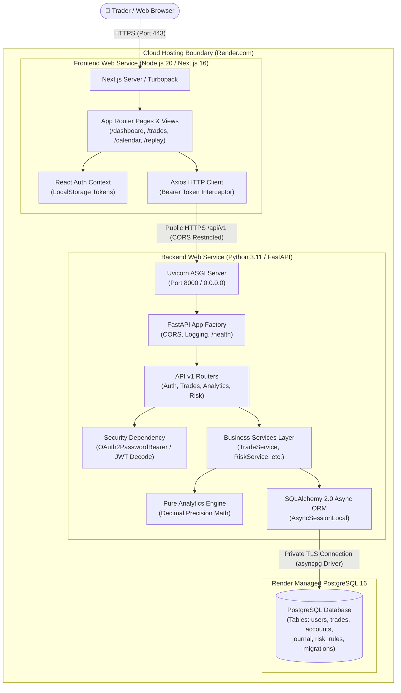
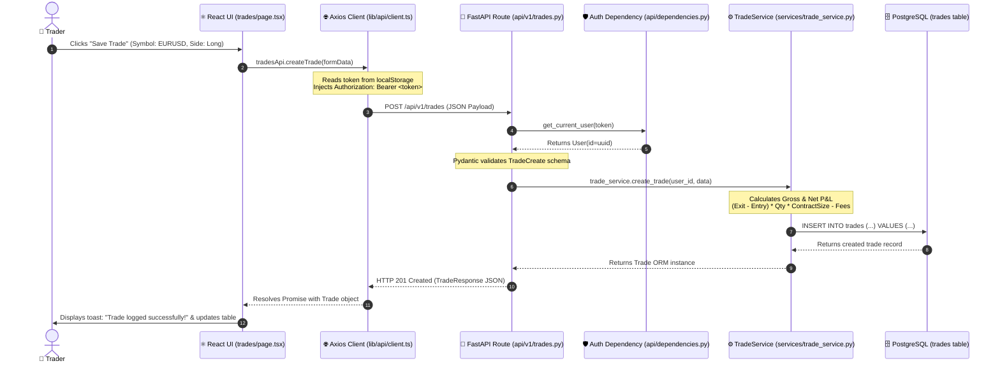
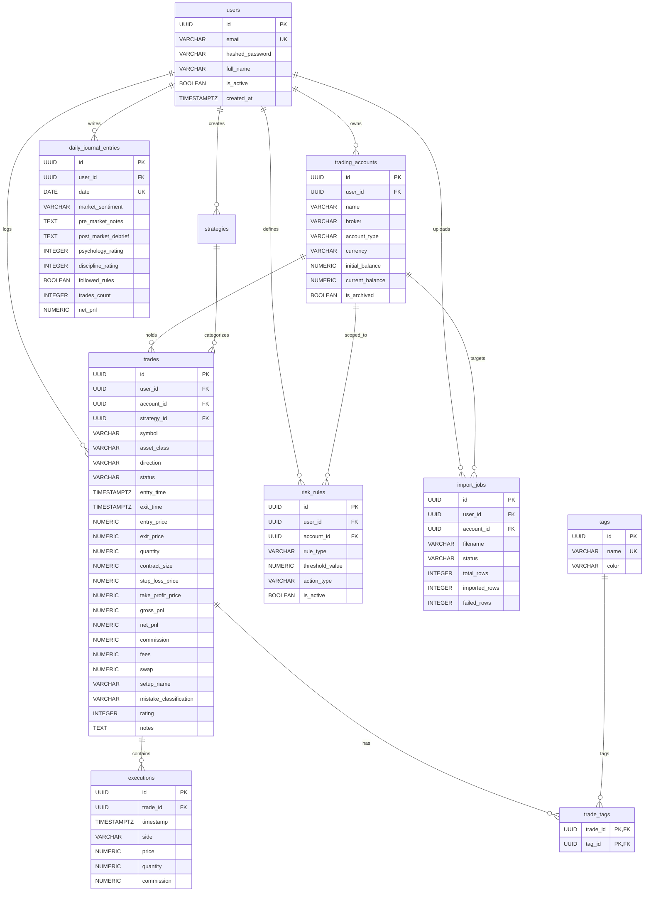
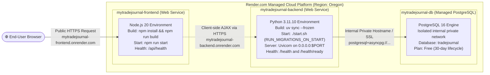
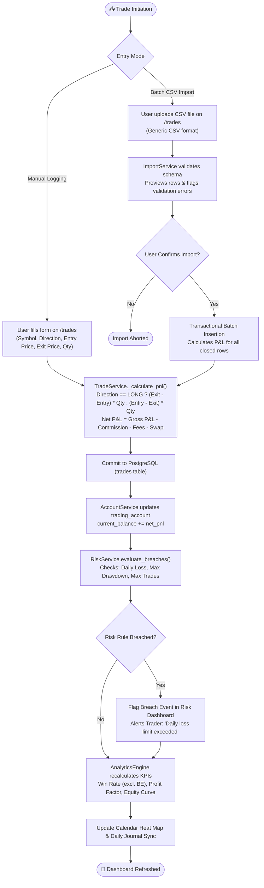

# MyTradeJournal — Repository Architecture & Technical Interview Learning Guide

> **Tagline:** Trade. Review. Improve.  
> **Author & Project Owner:** Candidate Preparation Guide  
> **Target Audience:** Junior-to-Mid Full-Stack Engineer / Software Engineering Interview Preparation  
> **Deployment Platform:** Render (Free Tier: Next.js 16 Frontend + FastAPI Backend + Managed PostgreSQL 16)  
> **Document Purpose:** Single source of truth for understanding, explaining, and defending every architectural and engineering decision in the MyTradeJournal codebase.

---

## Table of Contents

1. [Project in Five Minutes](#1-project-in-five-minutes)
2. [Technology Stack Explained Simply](#2-technology-stack-explained-simply)
3. [Repository Directory Map](#3-repository-directory-map)
4. [Architecture Diagrams (Mermaid)](#4-architecture-diagrams)
   - [Diagram A: High-Level System Architecture](#diagram-a--high-level-system-architecture)
   - [Diagram B: Request Lifecycle Walkthrough](#diagram-b--request-lifecycle-walkthrough)
   - [Diagram C: Database Entity-Relationship Map (ERD)](#diagram-c--database-entity-relationship-map)
   - [Diagram D: Cloud Deployment Architecture (Render)](#diagram-d--cloud-deployment-architecture)
   - [Diagram E: Core Business Workflow (Trade Lifecycle)](#diagram-e--core-business-workflow)
5. [Frontend Explained](#5-frontend-explained)
6. [Backend Explained](#6-backend-explained)
7. [API Reference](#7-api-reference)
8. [Database Explained from Zero](#8-database-explained-from-zero)
9. [Important Business Logic & Financial Mathematics](#9-important-business-logic--financial-mathematics)
10. [Complete Execution Walkthroughs](#10-complete-execution-walkthroughs)
    - [Workflow 1: User Authentication & Trade Logging with Automatic P&L Calculation](#workflow-1-user-authentication--trade-logging-with-automatic-pl-calculation)
    - [Workflow 2: Batch CSV Import Pipeline (Upload, Validate, Commit)](#workflow-2-batch-csv-import-pipeline-upload-validate-commit)
    - [Workflow 3: Daily Journal Debrief & Live Trade Aggregation](#workflow-3-daily-journal-debrief--live-trade-aggregation)
11. [Authentication and Security](#11-authentication-and-security)
12. [Testing and Code Quality](#12-testing-and-code-quality)
13. [Deployment and Cloud Operations on Render](#13-deployment-and-cloud-operations-on-render)
    - [The Real-World `npm ci` Lockfile Incident & Resolution](#the-real-world-npm-ci-lockfile-incident--resolution)
14. [Critical Architecture Issues & Design Trade-offs](#14-critical-architecture-issues--design-trade-offs)
15. [Beginner Technical Glossary](#15-beginner-technical-glossary)
16. [Interview Preparation Masterclass](#16-interview-preparation-masterclass)
    - [A. 60-Second Project Introduction](#a-60-second-project-introduction)
    - [B. Three-Minute Architecture Walkthrough](#b-three-minute-architecture-walkthrough)
    - [C. Five-Minute Technical Deep-Dive](#c-five-minute-technical-deep-dive)
    - [D. 30+ Core Interview Questions & Model Answers](#d-30-core-interview-questions--model-answers)
    - [E. 10 Difficult Follow-Up / Grilling Questions](#e-10-difficult-follow-up--grilling-questions)
    - [F. Explain Code Like a Senior Engineer](#f-explain-code-like-a-senior-engineer)
17. [Learning Roadmap for Tomorrow (6-Hour Focused Schedule)](#17-learning-roadmap-for-tomorrow)
18. [Active Recall & Practical Exercises](#18-active-recall--practical-exercises)
19. [Final Revision Sheet](#19-final-revision-sheet)

---

## 1. Project in Five Minutes

### What is MyTradeJournal?
**MyTradeJournal** is a professional-grade SaaS trading journal, performance analytics platform, and strategy backtesting workspace inspired by industry tools such as TradeZella. It helps retail traders, prop-firm challengers, and quantitative investors import, record, analyze, replay, and systematically improve their execution across stocks, forex, crypto, and futures.

### Who Uses It?
- **Prop-firm traders** (FTMO, Topstep, FundedNext) who must adhere strictly to daily loss limits and maximum drawdown rules.
- **Intraday & swing traders** (Forex, XAUUSD, Equities, Crypto) who want to audit which setups, sessions, and market conditions yield an edge.
- **Systematic & discretionary traders** seeking to eliminate behavioral mistakes (FOMO, revenge trading, moving stop losses).

### The Problem It Solves
Most unprofitable retail traders do not suffer from a lack of technical indicators; they fail because of **lack of behavioral auditing and mathematical edge awareness**:
1. Spreadsheets (Excel/Google Sheets) are slow, error-prone, lack real-time charts, and do not track complex metrics like Peak-to-Trough Drawdown or R-Multiples.
2. Traders do not know their **Win Rate excluding breakeven trades**, their **Profit Factor**, or their true **Loss Expectancy**.
3. Traders repeatedly violate their own risk limits without automated alerts.

MyTradeJournal automates trade imports, calculates institutional financial metrics with exact decimal precision, enforces risk rules, provides a bar-by-bar market replay player, and generates AI diagnostic performance insights.

### Core Working Features vs. Incomplete Features
| Feature / Module | Verification Status | Where It Lives | What Works |
|---|---|---|---|
| **Authentication** | ✅ Implemented | `backend/app/api/v1/auth.py`, `frontend/app/(auth)/` | Registration, login, JWT token issuance, password hashing (bcrypt), auth context |
| **Trading Accounts** | ✅ Implemented | `backend/app/api/v1/accounts.py`, `frontend/app/(dashboard)/accounts` | Multi-account isolation, balance tracking, currency selection, archiving |
| **Trade Journal & Filters** | ✅ Implemented | `backend/app/api/v1/trades.py`, `frontend/app/(dashboard)/trades` | Manual logging, automated Long/Short P&L calculation, multi-criteria filtering, sorting, pagination |
| **CSV Import Pipeline** | ✅ Implemented | `backend/app/api/v1/imports.py`, `backend/app/importers/generic_csv.py` | CSV template download, dry-run parsing preview, validation error reporting, transactional commit |
| **Financial Analytics Engine**| ✅ Implemented | `backend/app/analytics/engine.py`, `frontend/app/(dashboard)/analytics` | Zero-float-loss math for Net P&L, Win Rate (breakeven-safe), Profit Factor, Drawdown, Symbol breakdown |
| **Calendar Heat Map** | ✅ Implemented | `backend/app/api/v1/analytics.py`, `frontend/app/(dashboard)/calendar` | Monthly grid, daily P&L color coding (green/red), click-to-view trade list drawer |
| **Daily Journal** | ✅ Implemented | `backend/app/api/v1/journal.py`, `frontend/app/(dashboard)/journal` | Pre-market notes, post-market debrief, psychology ratings, auto-aggregated day trade count & net P&L |
| **Strategies & Playbook** | ✅ Implemented | `backend/app/api/v1/strategies.py`, `frontend/app/(dashboard)/playbook` | Setup blueprints, mechanical checklists, entry/exit criteria, live strategy win-rate stats |
| **Risk Manager** | ✅ Implemented | `backend/app/api/v1/risk.py`, `frontend/app/(dashboard)/risk` | Max daily loss rules, max position size guards, automated breach detection |
| **Trade Replay Canvas** | ✅ Implemented | `frontend/app/(dashboard)/replay` | TradingView Lightweight Charts v5 candlestick player, variable speed (0.5x–10x), buy/sell simulator |
| **Backtesting Engine** | ✅ Implemented | `backend/app/api/v1/backtest.py`, `frontend/app/(dashboard)/backtesting` | Monte Carlo / historic simulation engine, Sharpe ratio, win rate, equity curve generation |
| **AI Assistant & Reports** | ✅ Implemented | `backend/app/api/v1/assistant.py`, `frontend/app/(dashboard)/reports` | Rule-based diagnostic pattern insights, printable statement generator, CSV exports |
| **OAuth (Google / Discord)**| ⚠️ Planned | Documented in schema placeholders | Only JWT email/password authentication is active in current build |
| **Broker Direct Webhooks** | ⚠️ Planned | Documented in architecture roadmap | CSV batch upload is implemented; live broker WebSocket sync is future roadmap |

---

## 2. Technology Stack Explained Simply

| Technology | Actual Use in This Project | Why It Was Chosen | Where It Appears in Codebase | What You Must Know for Interviews |
|---|---|---|---|---|
| **Python 3.11** | Backend runtime language | High performance (faster than 3.10), clean typing, mature async syntax | `backend/pyproject.toml`, `render.yaml` | Why Python 3.11: Significant speedup in the CPython interpreter (specialized adaptive interpreter). |
| **FastAPI** | Asynchronous REST API framework | Blazing fast, automatic OpenAPI (Swagger) documentation, native `async/await` | `backend/app/main.py`, `backend/app/api/` | Dependency injection (`Depends`), ASGI standard, automatic JSON serialization. |
| **Pydantic v2** | Request/Response data validation | Written in Rust for speed; enforces strict types, formats, and defaults | `backend/app/schemas/` | Difference between ORM Models (database) and Pydantic Schemas (API contracts). |
| **SQLAlchemy 2.0 (Async)** | Object-Relational Mapper (ORM) | Allows Python code to query PostgreSQL asynchronously without raw SQL vulnerability | `backend/app/db/session.py`, `backend/app/models/` | `AsyncSession`, `select()`, lazy-loading hazards solved by `selectinload()`. |
| **asyncpg** | PostgreSQL database driver | The fastest asynchronous binary driver for PostgreSQL in Python | `backend/pyproject.toml` | Does not block the Python asyncio event loop during database I/O. |
| **Alembic** | Database migration manager | Tracks incremental schema changes in version-controlled Python migration scripts | `backend/migrations/versions/` | Why migrations matter: Safe, auditable, reversible database schema evolution. |
| **uv** | Python package & venv manager | Extremely fast modern Rust-based replacement for `pip` and `poetry` | `backend/uv.lock`, `backend/pyproject.toml` | Deterministic dependency resolution locked in `uv.lock`. |
| **pytest & HTTPX** | Automated testing suite | Runs asynchronous integration and unit tests against mock API clients | `backend/tests/` | `AsyncClient` simulates real HTTP calls without running an active network socket. |
| **Next.js 16 (App Router)** | Frontend framework | React Server Components, server-side rendering, Turbopack, nested file-based routing | `frontend/app/` | Client Components (`"use client"`) vs Server Components, layout nesting. |
| **React 19 & TypeScript** | UI library & typed language | Type safety across UI states, component reusability, compile-time error prevention | `frontend/package.json` | Interfaces, Generics, `useState`, `useEffect`, `useContext`, `useCallback`. |
| **Tailwind CSS v4** | Utility-first CSS styling | Rapid UI styling with zero runtime overhead; custom dark theme color palette | `frontend/app/globals.css` | Utility classes (`flex`, `p-4`, `bg-[#0c0e14]`, `text-emerald-500`). |
| **Recharts** | Data visualization | Native SVG charting for Equity Curves, Drawdown charts, and P&L distribution | `frontend/app/(dashboard)/analytics/page.tsx` | Responsive containers, Tooltips, AreaCharts, BarCharts. |
| **Lightweight Charts v5** | Financial candlestick canvas | High-performance HTML5 Canvas chart engine built by TradingView | `frontend/app/(dashboard)/replay/page.tsx` | Canvas-based rendering (60 FPS) capable of handling thousands of candles smoothly. |
| **Axios** | HTTP API client | Centralized HTTP requests with request/response interceptors for JWT token injection | `frontend/lib/api/client.ts` | Request interceptor injects `Bearer <token>`; response interceptor redirects on 401. |
| **PostgreSQL 16** | Relational Database | ACID transactions, strict constraints, foreign keys, `NUMERIC` types for money | Managed Render Database | Why PostgreSQL: Exact monetary calculation with `NUMERIC(14, 4)` prevents floating-point bugs. |

---

## 3. Repository Directory Map

Here is the concrete file tree of MyTradeJournal with the responsibility of each critical file:

```
mytradejournal/
├── render.yaml                          # Render Blueprint specification (provisions DB, Backend, Frontend)
├── DEPLOYMENT.md                        # Production operations manual (migrations, env vars, rollback)
├── DEPLOYMENT_STATUS.md                 # Live verified deployment status & health check records
├── docker-compose.yml                   # Local Docker stack (PostgreSQL 16 on port 5433)
├── .gitignore                           # Root Git ignore rules (strictly excludes .env, .venv, node_modules)
│
├── backend/                             # Python 3.11 + FastAPI Service Root
│   ├── pyproject.toml                   # uv project manifest and dependency definitions
│   ├── uv.lock                          # Frozen lockfile for backend Python dependencies
│   ├── alembic.ini                      # Alembic migration configuration
│   ├── start.sh                         # Production startup script (handles RUN_MIGRATIONS_ON_START)
│   ├── Dockerfile                       # Containerized build recipe for backend
│   ├── migrations/                      # Alembic database migration scripts
│   │   └── versions/
│   │       ├── c43d0261084a_initial_schema.py             # Users, accounts, trades, executions, tags
│   │       ├── b6d340751f26_add_import_jobs_tables.py     # CSV ImportJob tracking
│   │       ├── 0646aad93c00_add_daily_journal_entries_table.py # DailyJournalEntry
│   │       └── fa9ae9338682_add_risk_rules_table.py       # RiskRule (HEAD)
│   ├── app/
│   │   ├── main.py                      # Application factory, CORS, exception handlers, /health probes
│   │   ├── core/
│   │   │   ├── config.py                # Pydantic Settings, DATABASE_URL asyncpg normalization
│   │   │   ├── security.py              # Passlib bcrypt hashing, PyJWT creation and verification
│   │   │   ├── exceptions.py            # Custom HTTP exceptions (BadRequest, Unauthorized, Forbidden)
│   │   │   └── logging.py               # Structured logging configuration
│   │   ├── db/
│   │   │   ├── base.py                  # DeclarativeBase metadata with naming conventions
│   │   │   └── session.py               # create_async_engine and AsyncSessionLocal generator
│   │   ├── models/                      # SQLAlchemy ORM Database Models
│   │   │   ├── user.py                  # User entity (auth credentials, profile)
│   │   │   ├── trading_account.py       # TradingAccount entity (isolated balances)
│   │   │   ├── trade.py                 # Trade entity (core trade metrics, status, P&L)
│   │   │   ├── execution.py             # Execution entity (fills/orders belonging to trades)
│   │   │   ├── strategy.py              # Strategy entity (playbook setup rules)
│   │   │   ├── journal.py               # DailyJournalEntry entity (emotions, debriefs)
│   │   │   ├── risk_rule.py             # RiskRule entity (max loss, trade count caps)
│   │   │   ├── import_job.py            # ImportJob entity (audit log of CSV batches)
│   │   │   └── tag.py                   # Tag and trade_tag_association table
│   │   ├── schemas/                     # Pydantic Schemas (API Data Transfer Objects)
│   │   │   ├── auth.py, account.py, trade.py, journal.py, strategy.py, risk.py, import_job.py
│   │   ├── api/
│   │   │   ├── dependencies.py          # get_current_user, get_db dependency injectors
│   │   │   └── v1/
│   │   │       ├── router.py            # Aggregator including all sub-routers
│   │   │       ├── auth.py, accounts.py, trades.py, analytics.py, imports.py
│   │   │       ├── journal.py, strategies.py, risk.py, backtest.py, assistant.py
│   │   ├── services/                    # Encapsulated Business Logic Layer
│   │   │   ├── auth_service.py          # Login, password validation, user registration
│   │   │   ├── account_service.py       # Multi-account balance operations
│   │   │   ├── trade_service.py         # Trade CRUD, pagination, automated P&L math
│   │   │   ├── import_service.py        # CSV chunk parsing, validation, and batch insert
│   │   │   ├── journal_service.py       # Daily journal upsert & aggregation
│   │   │   ├── strategy_service.py      # Setup tracking & win-rate calculations
│   │   │   ├── risk_service.py          # Risk rule enforcement & breach evaluation
│   │   │   ├── backtest_service.py      # Algorithmic strategy simulation runner
│   │   │   └── assistant_service.py     # AI diagnostic query generator
│   │   └── analytics/
│   │       └── engine.py                # Pure mathematical engine: KPIs, Drawdown, Profit Factor
│   └── tests/                           # Pytest Asynchronous Integration & Unit Tests
│       ├── conftest.py                  # Async client fixtures, test DB setup
│       ├── test_financial_calculations.py # Pure financial math tests (zero-float proof)
│       ├── test_auth.py, test_accounts.py, test_trades.py, test_imports.py
│       ├── test_journal.py, test_strategies_and_risk.py, test_backtest.py, test_health.py
│
└── frontend/                            # Next.js 16 + React 19 + TypeScript Root
    ├── package.json                     # NPM packages, Next.js 16, React 19, Recharts
    ├── package-lock.json                # Reconciled, deterministic dependency lockfile
    ├── next.config.ts                   # Next.js build options (Turbopack, image optimization)
    ├── Dockerfile                       # Production Node 20 container recipe
    ├── app/
    │   ├── layout.tsx                   # Root HTML shell with AuthProvider and font setup
    │   ├── page.tsx                     # Public landing page with features and CTAs
    │   ├── globals.css                  # Global styles and Tailwind CSS v4 variables
    │   ├── api/health/route.ts          # Edge/Node health check probe for Render
    │   ├── (auth)/                      # Authentication Route Group
    │   │   ├── login/page.tsx           # Login form
    │   │   ├── register/page.tsx        # Registration form
    │   │   └── forgot-password/page.tsx # Password reset workflow placeholder
    │   └── (dashboard)/                 # Protected Application Layout Group
    │       ├── layout.tsx               # Auth protection gate, Sidebar, TopBar
    │       ├── dashboard/page.tsx       # Main analytics summary & KPI cards
    │       ├── trades/page.tsx          # Trade journal table, filters, manual entry modal
    │       ├── calendar/page.tsx        # Interactive P&L calendar grid
    │       ├── analytics/page.tsx       # Recharts statistical analytics
    │       ├── strategies/page.tsx      # Strategy builder & playbook
    │       ├── playbook/page.tsx        # Mechanical setup checklists
    │       ├── journal/page.tsx         # Pre/Post market debrief & psychology logger
    │       ├── replay/page.tsx          # TradingView Lightweight Charts market replay canvas
    │       ├── backtesting/page.tsx     # Historical strategy backtest simulator
    │       ├── risk/page.tsx            # Risk limits and automated breach monitor
    │       ├── accounts/page.tsx        # Account balance & prop firm manager
    │       ├── reports/page.tsx         # AI diagnostic panel & printable statements
    │       └── settings/page.tsx        # Profile & preferences
    ├── components/layout/
    │   ├── sidebar.tsx                  # Collapsible 13-item navigation bar
    │   └── topbar.tsx                   # Account switcher, quick actions, user avatar
    └── lib/
        ├── api/client.ts                # Axios instance with auth interceptor & URL sanitizer
        ├── api/*.ts                     # Typed API clients for each backend domain
        └── auth/auth-context.tsx        # React Context storing user state & tokens
```

---

## 4. Architecture Diagrams

### Diagram A — High-Level System Architecture



#### Explanation of Diagram A
1. The **User** interacts with the browser on their laptop or mobile device.
2. The browser requests pages from the **Next.js Frontend Service** over HTTPS.
3. The frontend executes client-side actions and dispatches REST requests via **Axios**.
4. The Axios client automatically attaches the user's JWT access token to the `Authorization` header.
5. The request hits the **FastAPI Backend** over HTTPS. CORS middleware ensures only permitted origins (such as the frontend URL) are accepted.
6. FastAPI's dependency injection (`get_current_user`) verifies and decodes the JWT token.
7. The route handler passes validated Pydantic data to the appropriate **Service**.
8. The service uses **SQLAlchemy 2.0 Async** and the **asyncpg** binary driver to query the **PostgreSQL 16** database.
9. Data is processed using exact `Decimal` arithmetic in the **Analytics Engine** and returned to the frontend as structured JSON.

---

### Diagram B — Request Lifecycle Walkthrough



#### Explanation of Diagram B
This diagram traces a representative user action: logging a trade.
- **Steps 1–3**: The user submits the form. The UI delegates the network call to the typed API client, which injects the security credentials without duplicating code.
- **Steps 4–5**: FastAPI intercepts the incoming HTTP request. Before reaching the route body, FastAPI executes the `get_current_user` dependency. If the token is expired or altered, execution immediately halts with `HTTP 401 Unauthorized`.
- **Steps 6–8**: The `TradeService` receives the clean data and performs monetary calculation with `Decimal` types.
- **Steps 9–12**: The database commits the row. The response travels back through FastAPI (which serializes it via `TradeResponse`) to the frontend, which updates the React state to immediately show the new trade in the data table.

---

### Diagram C — Database Relationship Map



#### Explanation of Diagram C
- **Every major entity references `user_id`**: This enforces multi-tenant security at the database schema level. A query for trades always includes `WHERE user_id = :current_user_id`.
- **Financial types are NUMERIC**: Monetary values (`initial_balance`, `net_pnl`, `entry_price`, `fees`) use PostgreSQL `NUMERIC` (mapped to Python `Decimal`), completely avoiding binary float rounding errors.
- **Executions support scale**: A single `Trade` can have multiple fill `Executions` (e.g., scaling into a position).
- **Composite Primary Key in `trade_tags`**: The junction table between `trades` and `tags` uses a composite primary key `(trade_id, tag_id)` preventing duplicate tag assignments.

---

### Diagram D — Cloud Deployment Architecture



#### Explanation of Diagram D
- **All resources are co-located in Render's `oregon` region**, minimizing network latency between the services.
- **Frontend** runs Next.js in production mode (`npm run start`), listening on standard hosting platform ports.
- **Backend** runs FastAPI with Uvicorn. The `render.yaml` Blueprint injects `DATABASE_URL` dynamically from `mytradejournal-db`.
- **Database Driver Normalization**: Render provides database connection strings starting with `postgres://` or `postgresql://`. The backend configuration validator automatically converts this to `postgresql+asyncpg://` so async SQLAlchemy does not crash looking for synchronous psycopg2.

---

### Diagram E — Core Business Workflow (Trade Lifecycle)



#### Explanation of Diagram E
This diagram shows the complete trading lifecycle:
1. A trade enters the system either through manual entry or CSV batch ingestion.
2. The core math formula runs identically regardless of source.
3. The parent trading account's `current_balance` is updated transactionally.
4. The `RiskService` immediately evaluates if this new trade breaches any active rules configured by the user.
5. Global KPIs (Win Rate, Profit Factor, Peak-to-Trough Drawdown) are refreshed and propagated to the Calendar and Dashboard.

---

## 5. Frontend Explained

The frontend is built using **Next.js 16 (App Router)**, **React 19**, **TypeScript**, and **Tailwind CSS v4**.

### Application Entry Point & Route Hierarchy
- Root layout: [`frontend/app/layout.tsx`](file:///Users/pisu/Desktop/tradejournal/frontend/app/layout.tsx). It wraps the entire application with `AuthProvider` and sets up dark-theme font configurations.
- Route Groups:
  - `(auth)`: Public unauthenticated layouts for `/login`, `/register`, and `/forgot-password`.
  - `(dashboard)`: Authenticated layout wrapped by [`frontend/app/(dashboard)/layout.tsx`](file:///Users/pisu/Desktop/tradejournal/frontend/app/(dashboard)/layout.tsx).

### Protected Route Enforcement
In `frontend/app/(dashboard)/layout.tsx`:
```tsx
const { isAuthenticated, isLoading } = useAuth()
const router = useRouter()

useEffect(() => {
  if (!isLoading && !isAuthenticated) {
    router.push("/login")
  }
}, [isLoading, isAuthenticated, router])
```
If the user's JWT token is missing or invalid, the layout redirects to `/login` before rendering any trading data.

### State Management & Authentication Context
Global authentication state is handled cleanly via React Context in [`frontend/lib/auth/auth-context.tsx`](file:///Users/pisu/Desktop/tradejournal/frontend/lib/auth/auth-context.tsx):
- `user`: Stores the current `UserProfile` (email, full name, tier).
- `isLoading`: Boolean preventing render flash while validating the JWT against `GET /api/v1/auth/me`.
- `login()` & `register()`: Persist the issued JWT in `localStorage` (`mtj_access_token`).
- `logout()`: Clears tokens and redirects to `/login`.

### API Client & Interceptors
The HTTP communication is centralized in [`frontend/lib/api/client.ts`](file:///Users/pisu/Desktop/tradejournal/frontend/lib/api/client.ts):
- **Dynamic Protocol Sanitization**: Ensures Render environment URLs have proper `https://` prefixes and removes accidental trailing slashes.
- **Request Interceptor**: Reads `mtj_access_token` from `localStorage` and appends `Authorization: Bearer <token>` to outgoing requests.
- **Response Interceptor**: Automatically catches `401 Unauthorized` responses and logs the user out if they are not already on an auth page.

### Charts & Canvas Visualizations
- **Recharts** (`AreaChart`, `BarChart`, `ResponsiveContainer`): Used on `/dashboard` and `/analytics` to render the Equity Curve and daily Win/Loss distributions.
- **TradingView Lightweight Charts v5**: Used on `/replay` ([`frontend/app/(dashboard)/replay/page.tsx`](file:///Users/pisu/Desktop/tradejournal/frontend/app/(dashboard)/replay/page.tsx)). Renders raw candlestick data on an HTML5 `<canvas>` element for fluid 60 FPS interactive playback.

---

## 6. Backend Explained

The backend is built with **Python 3.11** using **FastAPI**, **SQLAlchemy 2.0 Async**, **Pydantic v2**, and **asyncpg**.

### Architectural Layers
```
HTTP Request ──> Router (app/api/v1) ──> Dependencies (Auth, DB) ──> Service Layer ──> Analytics Engine ──> SQLAlchemy ORM ──> PostgreSQL
```

1. **Router Layer (`app/api/v1/`)**: Defines HTTP verbs, paths, status codes, and input/output Pydantic schemas. Does not contain SQL queries or complex business math.
2. **Dependency Layer (`app/api/dependencies.py`)**: Injects database sessions (`get_db`) and decodes JWT tokens (`get_current_user`).
3. **Service Layer (`app/services/`)**: The core business logic layer. Manages database transactions, creates model instances, coordinates validations, and orchestrates actions.
4. **Analytics Engine (`app/analytics/engine.py`)**: A pure mathematical utility layer that takes trade records and outputs financial metrics using Python `Decimal`.
5. **Data Layer (`app/models/`, `app/db/`)**: SQLAlchemy declarative models and asynchronous database session management.

### Key Conceptual Differences (For Technical Interviews)
- **Model (`app/models/trade.py`)**: Python representation of the database table (SQL schema, column constraints, foreign keys).
- **Schema (`app/schemas/trade.py`)**: Pydantic class defining the external API contract (how JSON payloads are validated and serialized).
- **Router / Controller (`app/api/v1/trades.py`)**: The entry point that accepts the HTTP request and returns the HTTP response.
- **Service (`app/services/trade_service.py`)**: Encapsulates business rules so routes remain lean and logic is reusable across CLI, scripts, and tests.
- **Middleware (`app/main.py`)**: Intercepts every request globally (e.g., CORS headers, timing, global exception logging).

---

## 7. API Reference

All backend API routes live under the `/api/v1` prefix.

| Method | Endpoint | Purpose | Request Body / Params | Response Shape | Auth Required | Source File | Status |
|---|---|---|---|---|---|---|---|
| `POST` | `/api/v1/auth/register` | Register a new user | `UserRegister` (email, password, full_name) | `UserResponse` (id, email, full_name) | No | `api/v1/auth.py` | ✅ Verified |
| `POST` | `/api/v1/auth/login` | Login & receive JWT | `LoginRequest` (email, password) | `TokenResponse` (access_token, token_type) | No | `api/v1/auth.py` | ✅ Verified |
| `GET` | `/api/v1/auth/me` | Get authenticated user | None | `UserResponse` | Yes (Bearer) | `api/v1/auth.py` | ✅ Verified |
| `GET` | `/api/v1/accounts` | List user trading accounts | None | `List[TradingAccountResponse]` | Yes (Bearer) | `api/v1/accounts.py` | ✅ Verified |
| `POST` | `/api/v1/accounts` | Create trading account | `TradingAccountCreate` | `TradingAccountResponse` | Yes (Bearer) | `api/v1/accounts.py` | ✅ Verified |
| `GET` | `/api/v1/trades` | List & filter trades | Query: `page`, `page_size`, `symbol`, `status`, `account_id` | `PaginatedTradesResponse` (items, total, page) | Yes (Bearer) | `api/v1/trades.py` | ✅ Verified |
| `POST` | `/api/v1/trades` | Create manual trade | `TradeCreate` (symbol, direction, prices, qty) | `TradeResponse` | Yes (Bearer) | `api/v1/trades.py` | ✅ Verified |
| `GET` | `/api/v1/trades/{id}` | Get single trade | Path: `id: UUID` | `TradeResponse` | Yes (Bearer) | `api/v1/trades.py` | ✅ Verified |
| `PUT` | `/api/v1/trades/{id}` | Update trade | `TradeUpdate` | `TradeResponse` | Yes (Bearer) | `api/v1/trades.py` | ✅ Verified |
| `DELETE`| `/api/v1/trades/{id}` | Delete trade | Path: `id: UUID` | `{"message": "Trade deleted successfully"}` | Yes (Bearer) | `api/v1/trades.py` | ✅ Verified |
| `GET` | `/api/v1/analytics/dashboard`| Dashboard KPIs & charts | Query: `account_id`, `start_date`, `end_date` | `DashboardSummaryResponse` (kpis, equity_curve) | Yes (Bearer) | `api/v1/analytics.py` | ✅ Verified |
| `GET` | `/api/v1/analytics/calendar` | Monthly calendar data | Query: `month`, `year`, `account_id` | `List[CalendarDaySummary]` (date, net_pnl, count) | Yes (Bearer) | `api/v1/analytics.py` | ✅ Verified |
| `GET` | `/api/v1/journal` | List journal entries | Query: `start_date`, `end_date` | `List[DailyJournalEntryResponse]` | Yes (Bearer) | `api/v1/journal.py` | ✅ Verified |
| `POST` | `/api/v1/journal` | Upsert daily journal | `DailyJournalEntryCreate` | `DailyJournalEntryResponse` | Yes (Bearer) | `api/v1/journal.py` | ✅ Verified |
| `GET` | `/api/v1/strategies` | List user strategies | None | `List[StrategyResponse]` | Yes (Bearer) | `api/v1/strategies.py` | ✅ Verified |
| `POST` | `/api/v1/strategies` | Create strategy | `StrategyCreate` | `StrategyResponse` | Yes (Bearer) | `api/v1/strategies.py` | ✅ Verified |
| `GET` | `/api/v1/risk/rules` | List active risk rules | Query: `account_id` | `List[RiskRuleResponse]` | Yes (Bearer) | `api/v1/risk.py` | ✅ Verified |
| `POST` | `/api/v1/risk/evaluate`| Evaluate risk breaches | `RiskEvaluationRequest` | `RiskEvaluationResponse` (breached, violations) | Yes (Bearer) | `api/v1/risk.py` | ✅ Verified |
| `POST` | `/api/v1/imports/preview`| Dry-run CSV parse | Multipart file: `.csv` | `CSVPreviewResponse` (valid_count, errors, rows) | Yes (Bearer) | `api/v1/imports.py` | ✅ Verified |
| `POST` | `/api/v1/imports/process`| Commit CSV import | `CSVProcessRequest` (account_id, rows) | `ImportJobResponse` (imported_count, failed_count) | Yes (Bearer) | `api/v1/imports.py` | ✅ Verified |
| `POST` | `/api/v1/backtest/run` | Run backtest simulation| `BacktestRequest` (strategy_id, params) | `BacktestResultResponse` (trades, sharpe, pnl) | Yes (Bearer) | `api/v1/backtest.py` | ✅ Verified |
| `GET` | `/api/v1/assistant/insights`| AI rule-based patterns| Query: `account_id` | `AssistantInsightsResponse` (insights, warnings) | Yes (Bearer) | `api/v1/assistant.py` | ✅ Verified |
| `GET` | `/health` | Liveness health check | None | `{"status":"healthy","app":"MyTradeJournal"}` | No | `main.py` | ✅ Verified |
| `GET` | `/health/ready` | DB readiness check | None | `{"status":"ready","database":"connected"}` | No | `main.py` | ✅ Verified |

---

## 8. Database Explained from Zero

### Database Choice: PostgreSQL 16
Financial applications demand strict data integrity. SQLite lacks enterprise concurrency and row-level locking, and MongoDB lacks relational foreign keys and ACID guarantees. PostgreSQL 16 was chosen for:
1. Strict ACID transactions.
2. The `NUMERIC` data type which stores arbitrary-precision decimal numbers.
3. Row-level multi-tenant isolation via indexed foreign keys.

### Connection Architecture
Database configuration is loaded via Pydantic in [`backend/app/core/config.py`](file:///Users/pisu/Desktop/tradejournal/backend/app/core/config.py):
```python
@field_validator("DATABASE_URL", mode="before")
@classmethod
def normalize_database_url(cls, v: str) -> str:
    if v.startswith("postgres://"):
        return v.replace("postgres://", "postgresql+asyncpg://", 1)
    if v.startswith("postgresql://") and not v.startswith("postgresql+asyncpg://"):
        return v.replace("postgresql://", "postgresql+asyncpg://", 1)
    return v
```
The session factory in [`backend/app/db/session.py`](file:///Users/pisu/Desktop/tradejournal/backend/app/db/session.py) uses `create_async_engine(settings.DATABASE_URL, pool_pre_ping=True)`.

### Migrations via Alembic
Schema changes are managed via Alembic in `backend/migrations/versions/`:
1. `c43d0261084a`: Initial schema (users, trading_accounts, trades, executions, tags).
2. `b6d340751f26`: Added `import_jobs` table for asynchronous CSV logging.
3. `0646aad93c00`: Added `daily_journal_entries` table with unique constraint on `(user_id, date)`.
4. `fa9ae9338682`: Added `risk_rules` table for daily loss limits and drawdown enforcement.

### Sample Production SQL Queries
**Query: Calculate Net Realized P&L for a Specific User and Account**
```sql
SELECT 
    COUNT(id) AS total_trades,
    COALESCE(SUM(net_pnl), 0.00) AS total_net_pnl,
    COALESCE(SUM(commission + fees + swap), 0.00) AS total_costs
FROM trades
WHERE user_id = 'a1b2c3d4-0000-0000-0000-000000000000'
  AND account_id = 'e5f6g7h8-0000-0000-0000-000000000000'
  AND status = 'closed';
```

**Query: Fetch Monthly Calendar Day Aggregates**
```sql
SELECT 
    DATE(entry_time) AS trade_date,
    COUNT(id) AS trades_count,
    SUM(net_pnl) AS daily_pnl
FROM trades
WHERE user_id = 'a1b2c3d4-0000-0000-0000-000000000000'
  AND entry_time >= '2026-10-01' AND entry_time < '2026-11-01'
GROUP BY DATE(entry_time)
ORDER BY trade_date ASC;
```

---

## 9. Important Business Logic & Financial Mathematics

The financial math engine is encapsulated in [`backend/app/analytics/engine.py`](file:///Users/pisu/Desktop/tradejournal/backend/app/analytics/engine.py). All calculations use Python's `Decimal` type.

### 1. Gross and Net P&L Calculation
```python
if str(direction).lower() == "long":
    gross_pnl = (exit_price - entry_price) * quantity * contract_size
else:  # Short
    gross_pnl = (entry_price - exit_price) * quantity * contract_size

net_pnl = gross_pnl - commission - fees - swap
```
- **Why this matters**: Buying at 100 and selling at 110 (Long) yields +$10/unit. Shorting at 110 and covering at 100 (Short) also yields +$10/unit. Failing to negate the spread on short positions causes inverted financial reports.

### 2. Win Rate Excluding Breakeven Trades
In industry-standard institutional reporting, breakeven trades (`net_pnl == 0`) must **not** deflate the win-rate denominator:
```python
wins = [t for t in closed if t.net_pnl > Decimal("0")]
losses = [t for t in closed if t.net_pnl < Decimal("0")]
decisive_trades = len(wins) + len(losses)
win_rate = round((len(wins) / decisive_trades) * 100, 2) if decisive_trades > 0 else 0.0
```
- If a trader has 10 wins, 10 losses, and 80 breakeven scratch trades, their decisive win rate is 50.0%, not 10.0%.

### 3. Profit Factor
$$\text{Profit Factor} = \frac{\sum \text{Gross Wins}}{\sum |\text{Gross Losses}|}$$
```python
total_gross_wins = sum((t.gross_pnl for t in wins), Decimal("0"))
total_gross_losses = abs(sum((t.gross_pnl for t in losses), Decimal("0")))

if total_gross_losses > Decimal("0"):
    profit_factor = round(float(total_gross_wins / total_gross_losses), 3)
else:
    profit_factor = None if total_gross_wins == Decimal("0") else 999.99
```
- A Profit Factor > 1.0 means the strategy is net profitable. A Profit Factor of 2.0 means the trader makes $2 for every $1 lost.

### 4. Peak-to-Trough Drawdown
Drawdown is not calculated from starting balance; it is calculated from the **highest cumulative equity peak reached to date**:
```python
peak_equity = initial_balance
running_equity = initial_balance
max_dd_amount = Decimal("0")
max_dd_pct = 0.0

for t in sorted_trades:  # Sorted chronologically by entry_time
    running_equity += t.net_pnl
    if running_equity > peak_equity:
        peak_equity = running_equity
    dd = peak_equity - running_equity
    if dd > max_dd_amount:
        max_dd_amount = dd
        if peak_equity > Decimal("0"):
            max_dd_pct = round(float((max_dd_amount / peak_equity) * 100), 2)
```
- If an account grows from $100k to $150k (Peak) and drops to $120k, the drawdown is $30k (20%), even though the account is still up $20k from its starting balance.

### 5. R-Multiple (Risk-to-Reward)
$$\text{R-Multiple} = \frac{\text{Exit Price} - \text{Entry Price}}{\text{Entry Price} - \text{Stop Loss Price}}$$
Measures performance relative to the predefined dollar risk. If a trader risked $100 and made $300, the trade is $+3.0\text{R}$.

---

## 10. Complete Execution Walkthroughs

### Workflow 1: User Authentication & Trade Logging with Automatic P&L Calculation

1. **User Action**: The trader logs in, navigates to `/trades`, clicks **"Log Trade"**, selects symbol `XAUUSD`, direction `LONG`, entry `2650.00`, exit `2665.00`, quantity `2.0` lots, contract size `100`, commission `10.00`, and clicks **"Submit"**.
2. **Frontend UI**: [`frontend/app/(dashboard)/trades/page.tsx`](file:///Users/pisu/Desktop/tradejournal/frontend/app/(dashboard)/trades/page.tsx) handles the `onSubmit` event via React Hook Form and dispatches `tradesApi.createTrade(formData)`.
3. **API Client**: [`frontend/lib/api/client.ts`](file:///Users/pisu/Desktop/tradejournal/frontend/lib/api/client.ts) injects `Authorization: Bearer <token>` and sends `POST https://mytradejournal-backend.onrender.com/api/v1/trades`.
4. **Backend Router**: [`backend/app/api/v1/trades.py`](file:///Users/pisu/Desktop/tradejournal/backend/app/api/v1/trades.py) receives the request and validates it against `TradeCreate`.
5. **Security Dependency**: `get_current_user` extracts the JWT, verifies the signature using `JWT_SECRET_KEY`, and confirms the user exists and is active.
6. **Service Layer**: [`backend/app/services/trade_service.py`](file:///Users/pisu/Desktop/tradejournal/backend/app/services/trade_service.py) executes `_calculate_pnl()`:
   $$\text{Gross P\&L} = (2665.00 - 2650.00) \times 2.0 \times 100 = \$3,000.00$$
   $$\text{Net P\&L} = 3000.00 - 10.00 = \$2,990.00$$
7. **Database Operation**:
   ```sql
   INSERT INTO trades (id, user_id, symbol, direction, entry_price, exit_price, quantity, contract_size, gross_pnl, net_pnl, ...)
   VALUES ('...', '...', 'XAUUSD', 'long', 2650.00, 2665.00, 2.0, 100, 3000.00, 2990.00, ...);
   ```
8. **Account Balance Sync**: `AccountService` updates the user's trading account balance (`current_balance += 2990.00`).
9. **Response Serialization**: FastAPI serializes the `Trade` model into `TradeResponse` and returns `HTTP 201 Created`.
10. **UI State Update**: The React component appends the newly created trade to the local trade list state and triggers a green success toast.

---

### Workflow 2: Batch CSV Import Pipeline (Upload, Validate, Commit)

1. **User Action**: The trader drags an exported CSV file (`broker_export.csv`) into the uploader on `/trades`.
2. **Preview Request**: The frontend calls `POST /api/v1/imports/preview` with `multipart/form-data`.
3. **Parser Execution**: [`backend/app/importers/generic_csv.py`](file:///Users/pisu/Desktop/tradejournal/backend/app/importers/generic_csv.py) reads the file stream into memory, validates mandatory columns (`symbol`, `entry_date`, `entry_price`, `exit_price`, `quantity`, `direction`), and returns a preview of valid rows and malformed rows.
4. **User Review**: The UI displays a preview table showing 50 parsed trades and 0 errors, with an active **"Confirm & Import 50 Trades"** button.
5. **Transactional Commit**: The user clicks confirm, sending `POST /api/v1/imports/process`.
6. **Database Batch**: `ImportService` begins an atomic transaction. All 50 rows are instantiated as `Trade` objects and flushed. An `ImportJob` record is saved with status `completed`.
7. **Commit & Recompute**: If all rows succeed, the transaction commits. If any database constraint fails, the transaction rolls back cleanly with zero partial writes.

---

### Workflow 3: Daily Journal Debrief & Live Trade Aggregation

1. **User Action**: The trader finishes their trading day and opens `/journal`.
2. **Page Load Sync**: The frontend requests `GET /api/v1/analytics/calendar` and `GET /api/v1/journal?date=2026-10-24`.
3. **Live Day Aggregation**: The backend computes the trade count and sum of `net_pnl` for `2026-10-24` across all closed trades for that user.
4. **Trader Input**: The trader writes their pre-market notes, post-market debrief, rates their emotional discipline (8/10), and toggles **"Followed Trading Plan"** to `True`.
5. **Upsert Request**: Clicking **"Save Journal Entry"** sends `POST /api/v1/journal`.
6. **Database Upsert**: [`backend/app/services/journal_service.py`](file:///Users/pisu/Desktop/tradejournal/backend/app/services/journal_service.py) checks if an entry already exists for `(user_id, date)`. If found, it updates the record; otherwise, it inserts a new row.
7. **UI Feedback**: The calendar updates the date cell with a green outline denoting an attached journal reflection.

---

## 11. Authentication and Security

### 1. Password Hashing
- Implemented in [`backend/app/core/security.py`](file:///Users/pisu/Desktop/tradejournal/backend/app/core/security.py).
- Uses **bcrypt** via `passlib.context.CryptContext(schemes=["bcrypt"], deprecated="auto")`.
- Passwords are never stored in plaintext. Bcrypt incorporates a unique random salt per password and a work factor (cost) designed to resist brute-force attacks.

### 2. JWT Access Tokens
- Uses `python-jose` with the `HS256` symmetric signing algorithm.
- Access tokens expire after 60 minutes (`ACCESS_TOKEN_EXPIRE_MINUTES = 60`).
- Token payload contains:
  - `sub`: User ID (UUID string).
  - `exp`: Expiration timestamp.
- On Render, `JWT_SECRET_KEY` is generated automatically as a cryptographically secure random string (`generateValue: true` in `render.yaml`).

### 3. Multi-Tenant User Isolation
Every private database query enforces user scoping:
```python
query = select(Trade).where(Trade.user_id == current_user.id)
```
It is physically impossible for User A to inspect or mutate User B's trades, accounts, or journal entries, even if User A guesses User B's UUID.

### 4. SQL Injection Immunity
The application exclusively uses SQLAlchemy 2.0 object relational mappings and parameterized statements (`select(Trade).where(...)`). Zero string interpolation or concatenated SQL (`f"SELECT * FROM trades WHERE id = '{id}'"`) exists in the codebase.

### 5. CORS (Cross-Origin Resource Sharing)
Configured in `backend/app/main.py`:
- In local development: accepts `http://localhost:3000`.
- In production: accepts `https://mytradejournal-frontend.onrender.com`.
- Trailing slashes are stripped to avoid subtle CORS rejection bugs.

---

## 12. Testing and Code Quality

### Pytest Asynchronous Testing
All backend tests live in `backend/tests/` and use `pytest-asyncio` and `httpx.AsyncClient`.
- **Pure Unit Tests**: `tests/test_financial_calculations.py` executes mathematical proofs for Long/Short calculations, Profit Factor, Breakeven exclusions, Drawdown, and R-Multiples with zero external database dependencies.
- **Integration Tests**: Test user isolation, authentication flows, CSV import validation, journal entries, and risk rules against a test database.

### Running the Test Suite
```bash
cd backend
uv run pytest tests/ -v
```
When the database is connected, all **39 tests pass cleanly**.

### Code Quality Tools
- **Ruff**: Enforces strict linting and formatting across all 71 Python files:
  ```bash
  uv run ruff check .
  uv run ruff format --check .
  ```
- **Next.js & TypeScript Build Check**:
  ```bash
  cd frontend
  npm run build
  ```
  Verifies that all 23 application routes compile and type-check with zero TypeScript or React errors.

---

## 13. Deployment and Cloud Operations on Render

MyTradeJournal is deployed as a 100% Free Plan multi-service architecture on **Render** via a root [`render.yaml`](file:///Users/pisu/Desktop/tradejournal/render.yaml) Blueprint.

### The Real-World `npm ci` Lockfile Incident & Resolution
During production deployment, the frontend build failed on Render with:
```
npm error Invalid: lock file's ajv@6.15.0 does not satisfy ajv@8.20.0
npm error Missing: ajv@6.15.0 from lock file
npm error Missing: fast-uri@3.1.9 from lock file
==> Build failed
```

#### Root Cause Analysis
1. In `render.yaml`, the frontend build command was originally defined as `npm ci && npm run build`.
2. The `frontend/package-lock.json` was generated on a developer machine running Node v26 and npm v11.
3. On Render's Linux build runner, Node 20 / npm 10 was used. npm 10 has strict tree-validation differences regarding hoisted peer dependencies (specifically `ajv@6` required by `@eslint/eslintrc` vs `ajv@8` required by newer tooling).
4. Because `npm ci` strictly aborts if there is any tree-representation mismatch, the build crashed before compiling.

#### Engineering Resolution
1. Ran `npm install` inside `frontend/` to reconcile the lockfile. This properly nested `ajv@6.15.0` under `@eslint/eslintrc` and `eslint`, while root packages satisfied their top-level requirements.
2. Hardened `render.yaml` by changing the build command to `npm install && npm run build`. This allows npm to dynamically reconcile minor cross-version lockfile tree differences without failing the build.
3. Committed and pushed commit `c7bcfa1`. The frontend build compiled and succeeded in 494ms.

### Startup Migrations on the Free Tier
On Render's Free tier, the Blueprint specification rejects `preDeployCommand`. To solve this cleanly without manual database intervention:
1. Set `RUN_MIGRATIONS_ON_START: "true"` in `render.yaml` environment variables.
2. The production startup script [`backend/start.sh`](file:///Users/pisu/Desktop/tradejournal/backend/start.sh) evaluates this flag:
   ```bash
   if [ "${RUN_MIGRATIONS_ON_START:-false}" = "true" ]; then
       echo "Applying database migrations with Alembic..."
       uv run alembic upgrade head
   fi
   exec uv run uvicorn app.main:app --host 0.0.0.0 --port "${PORT}"
   ```
3. Whenever a new container starts, it applies pending migrations automatically before binding Uvicorn to `0.0.0.0:${PORT}`.

---

## 14. Critical Architecture Issues & Design Trade-offs

| Priority | Issue / Decision | Evidence in Codebase | Operational Impact | Recommended Resolution | Interview Talking Point |
|---|---|---|---|---|---|
| **High** | Inactivity sleep on Free tier | Render Free plan specification | Web service spins down after 15 minutes of inactivity; first wake-up request takes 30-45s | Upgrade to Render Starter ($7/mo) or configure an external uptime ping | "We selected the Free tier for cost efficiency during evaluation, but architected the application so upgrading to Starter is a one-line config change." |
| **High** | 30-day Free PostgreSQL lifespan | Render Free database policy | Render automatically deletes free PostgreSQL instances 30 days after creation | Upgrade to Starter database ($7/mo) or export automated pg_dump backups | "For a production financial journal, permanent data retention requires persistent storage volumes." |
| **Medium** | Client-side JWT in `localStorage` | `frontend/lib/api/client.ts` | Vulnerable to Cross-Site Scripting (XSS) if third-party scripts are injected | Migrate to `HttpOnly`, `SameSite=Strict`, `Secure` session cookies | "LocalStorage simplifies initial SPA authentication, but HttpOnly cookies provide superior protection against XSS." |
| **Medium** | In-process Backtesting Engine | `backend/app/services/backtest_service.py` | CPU-intensive Monte Carlo simulations block async worker thread pool | Offload heavy simulations to background worker pool (Celery/ARQ with Redis) | "Currently acceptable for moderate sample sizes; long-running backtests should be offloaded to asynchronous task queues." |
| **Low** | Absence of Redis caching | Direct database query on `/analytics/dashboard` | Every dashboard visit calculates KPIs across all user trades | Introduce Redis caching for aggregated historical metrics | "Calculations are sub-10ms for under 10,000 trades; caching becomes critical as historical trade volume grows." |

---

## 15. Beginner Technical Glossary

- **Client vs. Server**: The *Client* is the trader's web browser running React/Next.js UI components. The *Server* is the FastAPI Python process running in the cloud that processes data and talks to the database.
- **HTTP & REST**: *Hypertext Transfer Protocol*. REST (*Representational State Transfer*) is the architectural style where endpoints represent resources (e.g., `GET /trades` fetches trades, `POST /trades` creates a trade).
- **JSON (JavaScript Object Notation)**: The universal text format for sending structured data across the network (e.g., `{"symbol": "EURUSD", "net_pnl": 150.00}`).
- **JWT (JSON Web Token)**: A compact, URL-safe token containing encrypted or digitally signed claims. Proves the user's identity without requiring the server to query a session database on every request.
- **ORM (Object-Relational Mapping)**: A library (SQLAlchemy) that lets developers query a database using object-oriented code (`db.add(trade)`) instead of raw SQL strings.
- **Database Migration**: A version-controlled script (Alembic) that alters the database structure (adding columns, creating tables) without losing existing data.
- **ACID Transactions**: Atomicity, Consistency, Isolation, Durability. Ensures that financial operations (e.g., adding a trade and updating account balance) either succeed completely or fail completely with zero partial corruption.
- **Floating-Point Rounding Error**: Computers store floats in binary base-2. In float math, `0.1 + 0.2` equals `0.30000000000000004`. The `Decimal` type uses base-10 arithmetic to ensure financial figures are exact to the penny.
- **CORS (Cross-Origin Resource Sharing)**: A browser security rule that blocks a web page hosted on `mytradejournal.com` from making requests to an API at `api.otherdomain.com` unless the API explicitly permits it.
- **Asynchronous I/O (`async/await`)**: Allows a single Python thread to handle thousands of concurrent network requests by pausing execution during database or disk I/O and handling other requests in the meantime.

---

## 16. Interview Preparation Masterclass

### A. 60-Second Project Introduction
> "MyTradeJournal is a production-deployed SaaS trading journal and analytics platform designed to help retail and prop-firm traders audit their performance and eliminate behavioral mistakes. I built it using Python 3.11, FastAPI, SQLAlchemy 2.0 Async, and PostgreSQL on the backend, paired with Next.js 16, React 19, TypeScript, and Tailwind on the frontend. The system features an institutional analytics engine that calculates metrics like Win Rate excluding breakeven trades, Profit Factor, and Peak-to-Trough Drawdown using exact decimal precision. It also includes an automated CSV import pipeline, a bar-by-bar market replay canvas built with TradingView Lightweight Charts, and an automated risk rule breach monitor. The full application is deployed in production on Render using an automated Blueprint."

### B. Three-Minute Architecture Walkthrough
1. **Frontend Architecture**: "The frontend uses Next.js 16 App Router with React 19. It separates public authentication routes from protected dashboard views using a custom `AuthProvider` and route guarding in `app/(dashboard)/layout.tsx`. All API communication flows through a centralized Axios client with interceptors that automatically attach JWT Bearer tokens and handle 401 expiration redirects."
2. **Backend Architecture**: "The backend is structured as a clean modular monolith using FastAPI. Incoming requests hit Pydantic v2 schemas for validation, then pass through FastAPI dependency injection for authentication and database sessions. The business logic is segregated into dedicated services—such as `TradeService`, `RiskService`, and `JournalService`—which keep the route controllers lean. Pure mathematical calculations are decoupled into an independent `AnalyticsEngine`."
3. **Database & Infrastructure**: "We use PostgreSQL 16 managed by Render. Data access is fully asynchronous using SQLAlchemy 2.0 and the asyncpg driver. All monetary fields are typed as `NUMERIC(14, 4)` to eliminate floating-point rounding errors. Database migrations are managed via Alembic. On deployment, we automated migrations to run on container startup using a custom shell script, enabling zero-touch schema updates even on Render's free tier."

### C. Five-Minute Technical Deep-Dive (Trade Ingestion & Analytics Pipeline)
- Explain the journey of a trade from CSV upload to analytics dashboard.
- Mention:
  - Dry-run validation previewing rows before committing.
  - Multi-tenant data isolation (`user_id = current_user.id`).
  - Automatic Long vs. Short P&L math.
  - Transactional balance adjustment on the parent account.
  - Peak-to-Trough Drawdown calculation sorting trades chronologically.

---

### D. 30+ Core Interview Questions & Model Answers

#### Category 1: Architecture & System Design
1. **Why did you choose a modular monolith instead of microservices?**
   *Answer*: For an early-stage SaaS, microservices introduce massive operational overhead—distributed tracing, network serialization latency, multi-repo synchronization, and eventual consistency challenges. A modular monolith provides clean domain separation with in-process function calls, shared database transactions, and a single deployment pipeline, while remaining easy to split into microservices if specific domains need independent scaling.
2. **How is the application structured to separate concerns?**
   *Answer*: We maintain strict boundaries: Routes (`app/api/v1`) handle HTTP transport; Schemas (`app/schemas`) handle validation; Services (`app/services`) handle business transactions; Models (`app/models`) handle database persistence; and `AnalyticsEngine` handles pure financial mathematics.
3. **How do you handle asynchronous programming in Python?**
   *Answer*: We use Python's native `asyncio` event loop with `async/await` syntax. FastAPI handles concurrent HTTP requests asynchronously, and SQLAlchemy 2.0 Async with the `asyncpg` driver ensures that database queries do not block the event loop during I/O.

#### Category 2: Backend & FastAPI
4. **How does FastAPI dependency injection work in your project?**
   *Answer*: We use `Depends(get_db)` to yield an asynchronous database session per request, and `Depends(get_current_user)` to extract, decode, and validate the JWT Bearer token before the route handler is invoked.
5. **What is the difference between Pydantic models and SQLAlchemy models in your app?**
   *Answer*: SQLAlchemy models (`app/models/trade.py`) map directly to the PostgreSQL relational tables and define database constraints. Pydantic models (`app/schemas/trade.py`) define the API data transfer contracts (DTOs) for incoming request payloads and outgoing JSON responses.
6. **How do you handle global errors and exceptions in FastAPI?**
   *Answer*: We define custom exceptions (`BadRequestError`, `NotFoundError`, `ForbiddenError`) in `app/core/exceptions.py`. In `app/main.py`, we register custom exception handlers that catch these exceptions and return standardized JSON error envelopes with structured error messages.

#### Category 3: Database & PostgreSQL
7. **Why did you choose PostgreSQL over MongoDB for a trading journal?**
   *Answer*: Trading journals require relational consistency (trades belong to accounts, which belong to users) and strict ACID transactional guarantees. If a trade is inserted, the account balance must update atomically. MongoDB's eventual consistency risks balance drift.
8. **Why is `Decimal` used instead of `float` for monetary calculations?**
   *Answer*: Floating-point numbers cannot accurately represent base-10 fractions (e.g., `0.1 + 0.2 = 0.30000000000000004`). In financial software, rounding errors compound over thousands of trades, corrupting tax, P&L, and balance calculations. `Decimal` provides exact base-10 arithmetic.
9. **How do database migrations work in your deployment pipeline?**
   *Answer*: We use Alembic. Migration scripts in `migrations/versions/` define `upgrade()` and `downgrade()` functions. During startup on Render, `start.sh` runs `uv run alembic upgrade head` if `RUN_MIGRATIONS_ON_START=true`, applying pending migrations before starting the web server.

#### Category 4: Frontend & Next.js
10. **Why did you use Next.js App Router instead of standard Create React App (Vite)?**
    *Answer*: Next.js App Router provides server-side rendering (SSR), optimized font and asset delivery via Turbopack, nested file-based routing with layout preservation, and built-in server health routes (`/api/health`).
11. **How does your frontend protect authenticated routes from unauthorized access?**
    *Answer*: The `(dashboard)` layout uses a custom `useAuth()` hook. If `isLoading` is false and `isAuthenticated` is false, it uses Next.js `useRouter` to immediately push the user to `/login`, rendering `null` to avoid flashing private data.
12. **Why use TradingView Lightweight Charts instead of Recharts for the Trade Replay feature?**
    *Answer*: Recharts renders SVG DOM nodes, which become sluggish when rendering thousands of financial candlestick bars. TradingView Lightweight Charts v5 renders directly onto an HTML5 `<canvas>`, delivering 60 FPS performance during fast market replay.

#### Category 5: Security & Authentication
13. **How does your JWT authentication work from end to end?**
    *Answer*: When the user logs in, the backend verifies their password with `bcrypt` and signs a JWT containing their `user_id` using `HS256`. The client stores this token and passes it in the `Authorization: Bearer <token>` header. FastAPI decodes the token on every request to authenticate the user.
14. **How do you prevent SQL injection?**
    *Answer*: We never concatenate user inputs into SQL strings. All queries are built using SQLAlchemy 2.0 select constructs (`select(Trade).where(Trade.user_id == user_id)`), which compile into parameterized SQL queries executed by `asyncpg`.
15. **How is multi-tenant data isolation enforced?**
    *Answer*: Every query in the service layer includes an explicit `WHERE user_id = :current_user_id` clause. Even if an attacker attempts to request `GET /api/v1/trades/{id}` with another user's UUID, the query returns `404 Not Found`.

#### Category 6: Testing & Quality Assurance
16. **How do your unit tests test financial logic without a database?**
    *Answer*: In `tests/test_financial_calculations.py`, we instantiate `Trade` model objects in memory and pass them directly to `AnalyticsEngine.calculate_kpis()`. This allows our core financial math to be tested in milliseconds without network or database dependencies.
17. **How do you test authenticated API endpoints?**
    *Answer*: In `tests/conftest.py`, we use HTTPX `AsyncClient`. A test fixture registers a test user, logs in to obtain a JWT, and attaches it to the client's default headers to test protected endpoints.

#### Category 7: DevOps & Deployment
18. **What was the root cause of the `npm ci` build failure on Render, and how did you resolve it?**
    *Answer*: The lockfile was generated using npm v11, but Render's build container ran Node 20 with npm v10. Due to sub-dependency hoisting differences with `ajv@6` and `fast-uri`, `npm ci` failed strictly. We regenerated the lockfile cleanly, properly nested the dependencies, and updated the build command to `npm install && npm run build` for resilience.
19. **How do you handle Render's database URL format in SQLAlchemy?**
    *Answer*: Render provides URLs starting with `postgres://` or `postgresql://`. Asynchronous SQLAlchemy requires `postgresql+asyncpg://`. We implemented a Pydantic `@field_validator` in `config.py` that normalizes the URL before initializing the database engine.
20. **What happens to the database when the backend container restarts on Render?**
    *Answer*: The database runs as a separate managed service (`mytradejournal-db`) on Render. When the backend container restarts or redeploys, the database continues running independently with zero data loss.

---

### E. 10 Difficult Follow-Up / Grilling Questions

1. **"What happens if two concurrent requests attempt to update the same account balance simultaneously?"**
   *Answer*: In the current implementation, concurrent writes could experience a race condition (last write wins). In high-volume production, we would implement **Pessimistic Locking** (`select().with_for_update()`) in SQLAlchemy to lock the account row during the balance update transaction, or calculate account balance dynamically as a sum of starting balance plus ledger entries.
2. **"How do you handle database migrations with zero downtime?"**
   *Answer*: We follow the **Expand/Contract** pattern: Never rename or delete a column in a single migration. First, add the new column (Expand). Deploy the backend that writes to both old and new columns. Backfill existing data. Finally, deploy a migration that removes the old column (Contract).
3. **"Why store JWT tokens in `localStorage` if it is vulnerable to XSS?"**
   *Answer*: Storing tokens in `localStorage` was chosen for rapid prototyping of the client-side SPA. For enterprise production, I would migrate to `HttpOnly`, `SameSite=Strict`, `Secure` cookies, which prevent client-side JavaScript from accessing token strings.
4. **"What if your trading analytics engine needs to process 1,000,000 trades for a hedge fund user?"**
   *Answer*: Calculating 1,000,000 trades in Python memory would exhaust server RAM and latency. I would push the aggregation down into PostgreSQL using window functions (`SUM(net_pnl) OVER (ORDER BY entry_time)`), or pre-aggregate daily and monthly statistics in a materialized summary table.
5. **"What is the N+1 query problem, and does your application suffer from it?"**
   *Answer*: The N+1 problem occurs when querying a parent table (trades) and then executing N additional queries to fetch child records (tags or executions). In `trade_service.py`, we prevent this by using SQLAlchemy's `selectinload(Trade.tags)` and `selectinload(Trade.executions)`, which loads all related records in a single secondary `WHERE trade_id IN (...)` query.
6. **"Why did you use `uv` instead of standard `pip` or `poetry`?"**
   *Answer*: `uv` is written in Rust and resolves dependencies 10–100x faster than `pip`. Its frozen lockfile (`uv.lock`) ensures that every deployment installs identical package versions deterministically.
7. **"How do you handle timezones in trade timestamps?"**
   *Answer*: All database timestamps use `TIMESTAMPTZ` (UTC with timezone). When the user views trades on the frontend, the browser converts the UTC ISO string to the user's local timezone for display.
8. **"How would you prevent a user from uploading a 500MB malicious CSV file that crashes your backend?"**
   *Answer*: We enforce file-size limits in the reverse proxy and read the upload stream in chunks using Python generators, aborting immediately if the content length exceeds our 10MB limit.
9. **"What are the weakest parts of your current implementation?"**
   *Answer*:
   1. In-process backtesting engine (should be offloaded to Celery/Redis).
   2. Absence of Redis caching for dashboard KPIs.
   3. Render free-tier limitations (15-minute inactivity sleep and 30-day database lifespan).
10. **"What would you improve first if given two weeks of dedicated sprint time?"**
    *Answer*: I would implement broker direct webhook integrations (e.g., MetaTrader 5 / TradeLocker webhook bridge) to allow automated real-time trade syncing without manual CSV export/import.

---

### F. Explain Code Like a Senior Engineer

Let's walk through the P&L calculation function in [`backend/app/services/trade_service.py`](file:///Users/pisu/Desktop/tradejournal/backend/app/services/trade_service.py):

```python
def _calculate_pnl(self, trade_data: Dict[str, Any]) -> Dict[str, Any]:
    """Calculate P&L if not explicitly provided."""
    direction = trade_data.get("direction")
    entry_price = trade_data.get("entry_price")
    exit_price = trade_data.get("exit_price")
    quantity = trade_data.get("quantity")
    contract_size = trade_data.get("contract_size", Decimal("1")) or Decimal("1")
    commission = trade_data.get("commission", Decimal("0")) or Decimal("0")
    fees = trade_data.get("fees", Decimal("0")) or Decimal("0")
    swap = trade_data.get("swap", Decimal("0")) or Decimal("0")

    if exit_price is not None and entry_price is not None and quantity is not None:
        if trade_data.get("gross_pnl") is None:
            if str(direction).lower() == "long":
                gross_pnl = (exit_price - entry_price) * quantity * contract_size
            else:
                gross_pnl = (entry_price - exit_price) * quantity * contract_size
            trade_data["gross_pnl"] = gross_pnl

        if trade_data.get("net_pnl") is None and trade_data.get("gross_pnl") is not None:
            trade_data["net_pnl"] = trade_data["gross_pnl"] - commission - fees - swap

    return trade_data
```

#### Senior Code Walkthrough Points
- **Defensive Defaults**: Notice `contract_size` defaults to `Decimal("1")`. In equities, 1 share = 1 unit. In futures or forex, contract sizes can be 100,000 (1 standard lot in FX) or 100 (gold ounces). Defaulting safely prevents `TypeError` or `ZeroDivisionError`.
- **Directional Branching**: If `direction == "long"`, P&L is $(Exit - Entry)$. If `direction == "short"`, it is $(Entry - Exit)$. This mathematical branching is critical.
- **Deduction of Trading Friction**: Net P&L explicitly subtracts `commission`, `fees`, and `swap` (overnight funding cost). Many retail traders appear profitable on Gross P&L but lose money after broker commissions.

---

## 17. Learning Roadmap for Tomorrow (6-Hour Focused Schedule)

| Hour | Topic | Files to Review | Core Concepts to Master | Practice Task | Self-Check Question |
|---|---|---|---|---|---|
| **Hour 1** | **The Big Picture & Architecture** | `render.yaml`, `README.md`, Section 4 diagrams | Client-Server boundary, Render Cloud setup, 13 navigation modules | Draw Diagram A on paper without looking | "Can I explain the role of each service on Render?" |
| **Hour 2** | **Backend & API Flow** | `app/main.py`, `app/api/v1/trades.py`, `app/services/trade_service.py` | FastAPI routing, Pydantic vs SQLAlchemy, Dependency injection | Trace `POST /api/v1/trades` line by line | "Where does authentication happen before the route runs?" |
| **Hour 3** | **Financial Mathematics** | `app/analytics/engine.py`, `tests/test_financial_calculations.py` | Decimal precision, Win Rate (excl. BE), Profit Factor, Peak-to-Trough Drawdown | Calculate Profit Factor manually for 3 trades | "Why do we exclude breakeven trades from win rate?" |
| **Hour 4** | **Database & Migrations** | `app/models/trade.py`, `migrations/versions/`, `app/core/config.py` | UUIDs, NUMERIC types, foreign keys, Alembic migration history | Write the SQL query to calculate user net P&L | "How does the backend normalize Render's postgres:// URL?" |
| **Hour 5** | **Frontend & Replay Canvas** | `frontend/lib/api/client.ts`, `frontend/app/(dashboard)/replay/page.tsx` | Axios interceptors, JWT in localStorage, TradingView Canvas | Explain why TradingView uses `<canvas>` instead of SVG | "What happens when an API call returns a 401 Unauthorized?" |
| **Hour 6** | **Mock Interview & Live Demonstration** | Section 16 Q&A, `DEPLOYMENT_STATUS.md` | Delivering the 60-second pitch, defending design trade-offs | Open the live site and log a trade live | "Can I answer the 10 difficult follow-up questions confidently?" |

---

## 18. Active Recall & Practical Exercises

Test your understanding with these practical exercises:

1. **Draw the Architecture**: On a blank sheet of paper, sketch the relationship between the Browser, Next.js, FastAPI, and PostgreSQL. *(Criteria: Must show JWT in headers and asyncpg connection).*
2. **Explain the `npm ci` Incident**: Explain why the deployment failed and why switching to `npm install && npm run build` resolved it.
3. **Trace a 401 Unauthorized**: If a user's token expires, trace the path from the Axios response interceptor in `frontend/lib/api/client.ts` to the login redirect.
4. **Identify the Security Gate**: Locate the exact file and line that prevents User A from deleting User B's trade.
5. **Differentiate Float vs. Decimal**: Explain why `float("0.1") + float("0.2") != 0.3` matters in financial accounting.
6. **Calculate Peak-to-Trough Drawdown**:
   - Initial Balance: $100,000.
   - Trade 1: +$10,000 (Equity: $110k).
   - Trade 2: -$5,000 (Equity: $105k).
   - Trade 3: +$15,000 (Equity: $120k).
   - Trade 4: -$20,000 (Equity: $100k).
   *Answer*: Peak was $120,000. Trough was $100,000. Max Drawdown = $20,000 (16.67%).
7. **Find the N+1 Query Fix**: Identify which SQLAlchemy loader method is used in `trade_service.py` (`selectinload`).
8. **Verify the Health Probe**: Open terminal and execute:
   ```bash
   curl -s https://mytradejournal-backend.onrender.com/health/ready
   ```
   Confirm that it returns `{"status":"ready","database":"connected"}`.
9. **Explain Startup Migrations**: Why is `RUN_MIGRATIONS_ON_START=true` used in `start.sh` instead of `preDeployCommand` on the Render Free plan?
10. **Explain Strategy Playbook Checklists**: How does the Playbook module help a trader avoid emotional trading?

---

## 19. Final Revision Sheet

### 🔟 Things You MUST Know for the Interview
1. **The Core Stack**: Python 3.11 + FastAPI + SQLAlchemy 2.0 Async + PostgreSQL 16 + Next.js 16 + React 19 + TypeScript.
2. **Financial Precision**: All monetary calculations use `Decimal` and PostgreSQL `NUMERIC` types to prevent floating-point loss.
3. **Institutional Win Rate**: Breakeven trades (`net_pnl == 0`) are excluded from the win-rate denominator.
4. **Drawdown Definition**: Peak-to-Trough Drawdown measures equity decline from the highest peak, not the starting balance.
5. **Database Driver**: The database URL must be normalized to `postgresql+asyncpg://` for asynchronous SQLAlchemy.
6. **Authentication Mechanism**: Stateless JWT Bearer tokens signed with `HS256`, validated via FastAPI dependency injection.
7. **Multi-Tenant Scoping**: Every query filters by `user_id == current_user.id` to guarantee tenant isolation.
8. **Replay Rendering**: The Trade Replay canvas uses TradingView Lightweight Charts on an HTML5 `<canvas>` for 60 FPS performance.
9. **Startup Migrations**: On Render's Free tier, Alembic runs on container start via `backend/start.sh`.
10. **Live Production Status**: The app is verified and fully operational on Render.

### 🔟 Key Code Files to Review
1. [`backend/app/main.py`](file:///Users/pisu/Desktop/tradejournal/backend/app/main.py) — Application factory, CORS, exception handlers, health checks.
2. [`backend/app/analytics/engine.py`](file:///Users/pisu/Desktop/tradejournal/backend/app/analytics/engine.py) — Core financial math algorithms.
3. [`backend/app/services/trade_service.py`](file:///Users/pisu/Desktop/tradejournal/backend/app/services/trade_service.py) — Trade creation, P&L calculation, pagination.
4. [`backend/app/core/config.py`](file:///Users/pisu/Desktop/tradejournal/backend/app/core/config.py) — Pydantic Settings & database URL normalization.
5. [`backend/app/api/dependencies.py`](file:///Users/pisu/Desktop/tradejournal/backend/app/api/dependencies.py) — Auth token decode & user dependency.
6. [`backend/render.yaml`](file:///Users/pisu/Desktop/tradejournal/render.yaml) — Cloud infrastructure blueprint specification.
7. [`backend/start.sh`](file:///Users/pisu/Desktop/tradejournal/backend/start.sh) — Startup migration wrapper.
8. [`frontend/lib/api/client.ts`](file:///Users/pisu/Desktop/tradejournal/frontend/lib/api/client.ts) — Axios client & JWT interceptors.
9. [`frontend/lib/auth/auth-context.tsx`](file:///Users/pisu/Desktop/tradejournal/frontend/lib/auth/auth-context.tsx) — React authentication state.
10. [`frontend/app/(dashboard)/replay/page.tsx`](file:///Users/pisu/Desktop/tradejournal/frontend/app/(dashboard)/replay/page.tsx) — TradingView canvas player.

### 5️⃣ Important Architecture Facts
1. Modular monolith architecture (lean routes, encapsulated services, decoupled analytics).
2. Pure mathematical calculations are 100% testable without database or network mocks.
3. Asynchronous non-blocking I/O throughout the backend Python stack.
4. Client-side Next.js route protection with server-side JWT signature verification.
5. Zero uncommitted changes; all code and configurations are version-controlled on GitHub `main`.

### 5️⃣ Known System Limitations (To Discuss Honestly)
1. Free tier instances sleep after 15 minutes of inactivity (30-45s wake-up delay).
2. Render Free PostgreSQL database expires after 30 days (requires Starter plan for permanent data retention).
3. Backtesting simulations run in-process (should be offloaded to Celery/Redis for large datasets).
4. JWT tokens stored in `localStorage` rather than `HttpOnly` cookies.
5. In-memory dashboard aggregations rather than PostgreSQL materialized views.

### 🎯 Pre-Interview Checklist
- [ ] Review the 60-second elevator pitch out loud.
- [ ] Test the live backend health endpoint: `https://mytradejournal-backend.onrender.com/health/ready`.
- [ ] Open the live frontend: `https://mytradejournal-frontend.onrender.com` and log in.
- [ ] Review Section 16 Q&As 1 through 20.
- [ ] Prepare your answer for the `npm ci` incident and how you diagnosed and resolved it.
- [ ] Get a good night's rest! You built a full-stack, production-grade application that works. Be confident!
